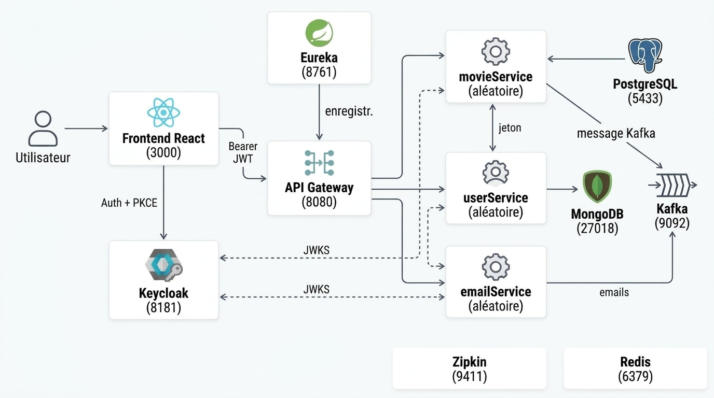

# CineVision : authentification et autorisation inter-services

Binôme : Ikram Moulay et Wissal Kallah.

L'application de départ est [CineVisionMicroserviceProject](https://github.com/VonHumbolt/CineVisionMicroserviceProject) de Kaan Kaplan.
Notre travail porte sur sa sécurisation (Keycloak, OAuth 2.0 / OIDC, JWT, RBAC / ABAC).

> **État actuel : version de référence, NON sécurisée.**
> Elle sert à documenter le comportement avant sécurisation. Les failles qu'elle contient sont listées en section 7.

---

## 1. Prérequis

| Outil | Version |
|---|---|
| JDK | 17 |
| IntelliJ IDEA | avec le plugin Lombok et l'annotation processing activé |
| Docker Desktop | démarré avant de lancer les commandes |
| Node.js | 16 ou 18 |
| Git | récent |

## 2. Architecture et ports

Le schéma ci-dessous présente l'architecture microservices de l'application, incluant l'authentification via Keycloak, le routage par l'API Gateway et la communication asynchrone avec Kafka.



| Composant | Rôle | Port |
|---|---|---|
| eureka-server | annuaire des services | 8761 |
| api-gateway | point d'entrée unique | 8080 |
| userService | comptes et login (MongoDB) | aléatoire |
| movieService | films, paiements, commentaires (PostgreSQL) | aléatoire |
| emailService | envoi de l'email du ticket (consomme Kafka) | aléatoire |
| frontend React | interface | 3000 |
| PostgreSQL | base de movieService | 5433 |
| MongoDB | base de userService | 27018 |
| Kafka | messages movieService vers emailService | 9092 |
| Zipkin | traçage des requêtes | 9411 |
| Redis | cache | 6379 |

Les services métier prennent un port aléatoire (`port: 0`) et s'enregistrent dans Eureka.
Pour trouver le port d'un service, regarder la ligne `Tomcat started on port(s)` de sa console.

## 3. Lancement

### 3.1 Infrastructure Docker

À la racine du projet :

```powershell
docker compose up -d postgres mongodb kafka zipkin redis
docker ps
```

Cinq conteneurs doivent être en état `Up`. Keycloak et mongo-express ne sont pas nécessaires à ce stade.

### 3.2 Services Spring Boot (dans IntelliJ)

1. Ouvrir le `pom.xml` **racine** avec File > Open, puis Open as Project.
2. Project Structure : SDK 17. Compiler > Annotation Processors : cocher Enable annotation processing.
3. Démarrer les applications **dans cet ordre**, en attendant `Started ...` à chaque fois :
   1. `EurekaServerApplication` (puis ouvrir http://localhost:8761, identifiants `eureka` / `password`)
   2. `UserServiceApplication`
   3. `MovieServiceApplication`
   4. `EmailServiceApplication`
   5. `ApiGatewayApplication`
4. Sur la page Eureka, quatre services doivent apparaître : USERSERVICE, MOVIESERVICE, EMAILSERVICE, API-GATEWAY.

### 3.3 Données de test (première fois seulement)

La base est vide au départ : sans ces scripts, la liste des films est vide et le bouton « Filmler » mène à `/movie/undefined`.

Conditions :

- `MovieServiceApplication` doit avoir démarré **au moins une fois**, car c'est Hibernate qui crée les tables.
- Les scripts s'exécutent **une seule fois**, sinon ils créent des doublons.

```powershell
Get-Content scripts\seed-postgres.sql | docker exec -i cinevision-postgres psql -U postgres -d cine_vision
Get-Content scripts\seed-mongo.js | docker exec -i mongodb mongosh -u rootuser -p rootpass --authenticationDatabase admin user
```

Puis **redémarrer `MovieServiceApplication`** (la liste vide a pu être mise en cache).

Le script Mongo crée les deux rôles (`CUSTOMER` et `ADMIN`). Sans eux, l'inscription crée un utilisateur sans rôle.

### 3.4 Frontend

```powershell
cd frontend
npm install        # ajouter --legacy-peer-deps en cas d'erreur de dépendances
npm start
```

Ouvrir http://localhost:3000 et **descendre dans la page** : le film apparaît sous l'onglet « Vizyonda » (à l'affiche).

Vocabulaire de l'interface (turc) :
Filmler = films, Vizyonda = à l'affiche, Yakında = bientôt, Kayıt ol = s'inscrire, Giriş = connexion, Bilet Al = acheter un billet, Yorum Yap = commenter, Film Ekle = ajouter un film (admin).

## 4. Vérifier que tout fonctionne

PowerShell, depuis n'importe quel dossier :

```powershell
# Liste des films via le Gateway
Invoke-RestMethod http://localhost:8080/api/movie/movies/displayingMovies

# Inscription
Invoke-RestMethod -Method Post -Uri http://localhost:8080/api/user/users/add -ContentType "application/json" -Body '{"customerName":"Test User","email":"test@test.com","phone":"0600000000","password":"Test1234"}'

# Connexion (renvoie le jeton JWT)
$r = Invoke-RestMethod -Method Post -Uri http://localhost:8080/api/user/auth/login -ContentType "application/json" -Body '{"email":"test@test.com","password":"Test1234"}'
$r
```

L'envoi réel de l'email nécessite un mot de passe d'application Gmail dans `emailService/src/main/resources/application.yml`.
Sans lui, le paiement fonctionne mais `emailService` affiche `535 Username and Password not accepted` : c'est attendu.

## 5. Problèmes fréquents

| Symptôme | Cause et solution |
|---|---|
| `container name "/postgres" is already in use` | un autre projet Docker utilise ce nom : le conteneur de ce projet s'appelle `cinevision-postgres` |
| `port is already allocated` | un autre programme utilise le port : changer le **premier** nombre de `"5432:5432"` dans `docker-compose.yml`, et le port dans l'`application.yml` du service concerné |
| `AuthenticationFailed` (Mongo) ou `authentification par mot de passe échouée` (Postgres) | une base installée sur Windows répond sur le même port que le conteneur : l'arrêter ou changer le port du conteneur |
| Kafka s'arrête avec `exec format error` | ancienne image `wurstmeister/kafka` incompatible avec un processeur ARM : le projet utilise maintenant `apache/kafka` |
| IntelliJ : `Cannot parse file ... .iml` | fermer IntelliJ, supprimer le dossier `.idea`, puis rouvrir le `pom.xml` racine |
| Liste de films vide | scripts de la section 3.3 non exécutés, ou `movieService` non redémarré |

## 6. Changements par rapport au projet d'origine

- Kafka : image `apache/kafka:3.8.0` (mode KRaft). Zookeeper a été supprimé.
- Conteneur Postgres renommé `cinevision-postgres`.
- Ajout du dossier `scripts/` (données de test) et de ce README.

## 7. Constats de sécurité (état de référence)

Vérifiés avec les commandes de la section 4 :

- Le Gateway est ouvert : `GET /api/movie/movies/displayingMovies` répond 200 sans jeton.
- `POST /api/movie/payments/sendTicketDetail` est accepté sans jeton et déclenche l'envoi d'un email à l'adresse fournie dans le body.
- Les services sont joignables directement sur leur port, sans passer par le Gateway.
- Le consumer Kafka d'`emailService` traite tout message reçu, sans vérifier son origine.
- Secrets en dur : identifiants Eureka, secret JWT HS256 (dans deux fichiers), mot de passe SMTP, mots de passe des bases.
- Le jeton JWT est valable 2 semaines et circule dans le body JSON.

## 8. Travail de sécurisation (en cours)

Keycloak, validation des JWT au Gateway, `@PreAuthorize` sur les écritures, jeton de service (Client Credentials) entre `movieService` et `userService`, tests.
Section à compléter au fil des phases.

## 9. Configuration des secrets (obligatoire)

1. `Copy-Item .env.example .env` (à la racine du projet)
2. Remplir `.env` avec ses propres valeurs (commandes de génération dans `.env.example`).
   Ce fichier n'est jamais commité.
3. `SMTP_USERNAME` / `SMTP_PASSWORD` : compte Gmail et mot de passe d'application.
   Sans eux, tout fonctionne sauf l'envoi réel de l'email.
